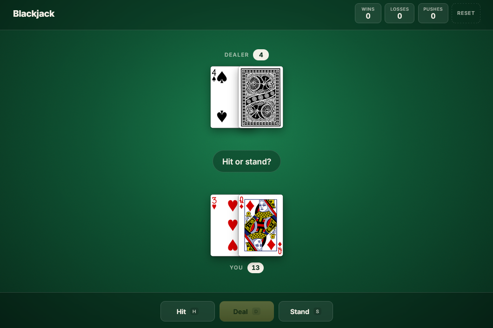
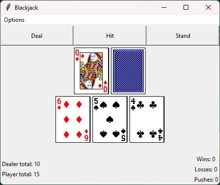

# Blackjack

Blackjack, built twice. The newer version is a browser game written in plain HTML, CSS and JavaScript. The original version is a Python/Tkinter desktop game I made as my CS121 final project.

Both versions use the same rules: aces count as 11 or 1, the dealer's second card stays face down until you stand, a two-card 21 is a Blackjack, the dealer draws until reaching 17, and hitting to 21 stands for you automatically.

## Web version



### Running it

Visit the website linked in this repo or Open `index.html` in a browser. No build step or server is needed, but you do need an internet connection, because cards are shuffled and drawn through the [Deck of Cards API](https://deckofcardsapi.com/).

### How it works

- Use the buttons or the keyboard: **D** to deal, **H** to hit, **S** to stand.
- Your wins, losses and pushes are saved in the browser's `localStorage`, and **Reset** clears them.

## Python version



### Running it

You need Python 3 with Tkinter installed

```sh
python blackjack.py
```

**NOTE:** Run the command from the repo folder. The game loads card images from `cards/` relative to the current directory, so it won't start if you run it from somewhere else.

### How it works

- **Deal** starts a new hand with a freshly shuffled 52-card deck. **Hit** draws a card, and **Stand** hands the turn to the dealer.
- Your wins, losses and pushes are saved to `scores.data`, so they're kept between sessions. That file is in `.gitignore`.
- The **Options** menu has the rules, a way to clear the scores, and Quit.
- Setting `SHOW_DEBUG = True` at the top of `blackjack.py` prints each hand and result to the console.
